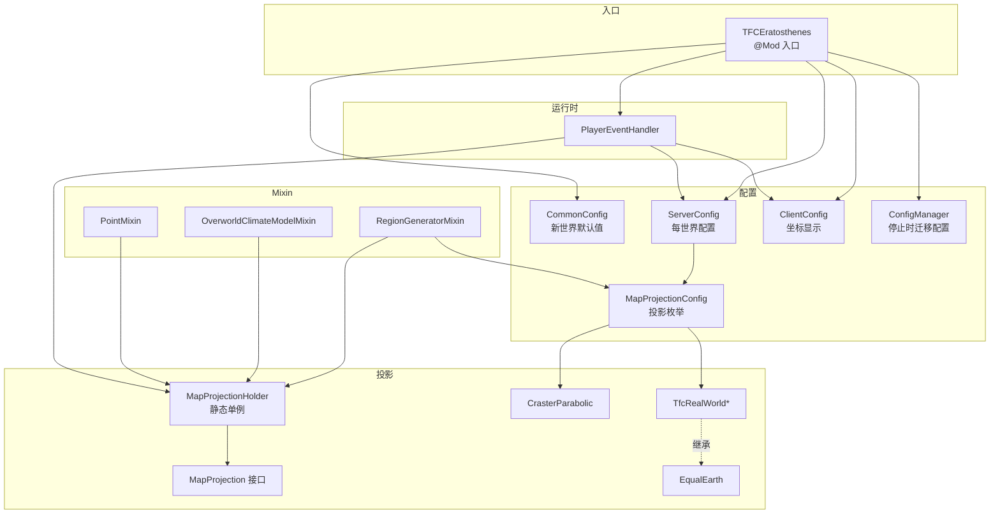
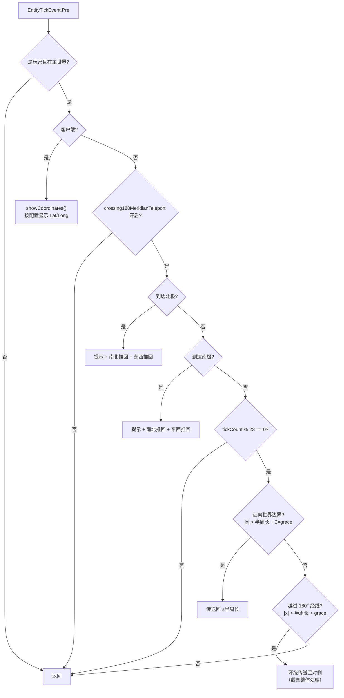

# TFC Eratosthenes 模组结构与功能解析

> **版权说明**：本文是对独立第三方模组 **TFC Eratosthenes**（作者 Trygve55，许可证
> **GPL-3.0-or-later**，源码 <https://github.com/trygve55/tfc_eratosthenes>）的结构与设计分析。
> 文中引用的代码、名称与素材版权归原作者所有，并遵循 GPL-3.0-or-later；本文仅用于研究与兼容性说明。
> 本仓库的模组代码是独立实现，不包含或复制 TFC Eratosthenes 的源代码。

> 版本：4.0.0（仅适用于 Minecraft 1.21.1）
> 模组 ID：`tfc_eratosthenes`
> 作者：Trygve55
> 许可证：GNU GPLv3

---

## 1. 模组概述

**TFC Eratosthenes** 是 TerraFirmaCraft（TFC:TNG）的附属模组，名字取自公元前 240 年首次测算地球周长的古希腊学者埃拉托斯特尼。它把 TFC 的世界生成改造成一张**首尾相接的球形世界地图**：玩家可以一路向东/向西航行并绕过"世界尽头"回到另一侧，就像在球面上环行一样。

核心目标：

- 用**地图投影（Map Projection）**约束 TFC 的大陆生成范围，使世界呈"球形"而非无限平面。
- 在 180° 经线处实现**环绕传送**（含船、马等载具）。
- 对南北极点区域做特殊处理，避免坐标系奇异点造成的穿模/卡死。
- 兼容 **TFC: Real World** 的 Equal Earth 投影与真实世界地图配置。
- 服务端必需，客户端可选；客户端仅提供坐标 HUD。

**依赖关系**

| 依赖 | 类型 | 版本 |
| --- | --- | --- |
| NeoForge | 必需 | 21.1.234+ |
| Minecraft | 必需 | 1.21.1 |
| TerraFirmaCraft (`tfc`) | 必需（AFTER） | 4.0.0-beta |
| TFC: Real World (`tfc_real_world`) | 可选 | 4.0 |

**技术栈**：Java 21、Gradle + NeoForge ModDevGradle 2.0.140、Mixin（SpongePowered）、Parchment 2024.11.17 映射。

---

## 2. 目录结构

```
fromgithub/
├─ build.gradle                 # ModDevGradle 构建脚本，声明 TFC / TFC Real World 依赖
├─ gradle.properties            # 模组元数据与依赖版本（MC 1.21.1 / Neo 21.1.234 / TFC 4.0.0）
├─ settings.gradle
├─ changelog.md                 # 版本变更记录
├─ TESTING.md                   # 手工测试清单
├─ GeographicLib_License.txt    # Equal Earth 投影算法来源的许可证
├─ img/Eratosthenes.png         # README 横幅
└─ src/main/
   ├─ templates/META-INF/neoforge.mods.toml   # 模组元数据模板（构建时变量替换）
   └─ resources/
      ├─ tfc_eratosthenes.mixins.json         # Mixin 配置（仅通用端，无 client mixin）
      └─ assets/tfc_eratosthenes/lang/en_us.json  # 配置界面本地化
   └─ java/net/trygve55/eratosthenes/
      ├─ TFCEratosthenes.java        # @Mod 入口
      ├─ MapProjectionHolder.java    # 当前地图投影的静态持有者
      ├─ PlayerEventHandler.java     # 实体 tick 事件：环绕传送 / 极点 / 坐标显示
      ├─ compat/TFCRealWorld.java    # 与 TFC: Real World 的可选兼容层
      ├─ config/
      │  ├─ CommonConfig.java        # 新世界默认值
      │  ├─ ServerConfig.java        # 每世界服务器配置
      │  ├─ ClientConfig.java        # 客户端坐标显示
      │  ├─ ConfigManager.java       # 服务器配置迁移到世界目录
      │  └─ MapProjectionConfig.java # 投影枚举 + 工厂
      ├─ mapprojections/
      │  ├─ MapProjection.java       # 投影接口（经纬度/半周长/大陆因子）
      │  ├─ CrasterParabolic.java    # 默认：Craster 抛物线投影
      │  ├─ Cylindrical.java         # 抽象等距圆柱投影（当前未被使用）
      │  ├─ EqualEarth.java          # Equal Earth 投影数学实现
      │  ├─ TfcRealWorld.java        # TFC Real World 投影的公共接口
      │  ├─ TfcRealWorldFullWorld.java
      │  ├─ TfcRealWorldHalfWorld.java
      │  ├─ TfcRealWorldNewWorld.java
      │  └─ TfcRealWorldOldWorld.java
      └─ mixins/
         ├─ RegionGeneratorMixin.java      # 替换大陆生成因子
         ├─ OverworldClimateModelMixin.java# 注入气候模型以初始化投影
         └─ PointMixin.java                # 过滤投影外的陆地/岛屿/山脉/火山
```

---

## 3. 架构总览

模组由四条主线组成：**投影数学层**、**世界生成注入层**、**运行时事件层**、**配置与兼容层**。



### 3.1 关键设计：投影单例

`MapProjectionHolder` 保存**当前世界的投影实例**，由两个 Mixin 在世界加载时写入：

- `RegionGeneratorMixin`（TFC 的地形区域生成器构造完成时）
- `OverworldClimateModelMixin`（TFC 的主世界气候模型构造完成时）

之所以要两处注入，是因为客户端可能只创建气候模型（用于温度/气候查询）而不创建区域生成器。取不到实例时 `get()` 会抛出 `IllegalStateException`（0.2.2 曾修复过由此引起的客户端连接崩溃）。

---

## 4. 地图投影系统

### 4.1 `MapProjection` 接口

```java
public interface MapProjection {
  int getHalfMeridian();                                  // 赤道到极点的距离（方块）
  float continentFactor(Region.Point point);              // 0~1，控制该点是否允许成陆
  float getEquatorOffset();                               // 赤道在 z 轴上的偏移
  int getHalfCircumferenceAtLatitude(float latitude);     // 指定纬度的半周长
  float getLatitude(float equatorDistance);
  float getLongitude(Vec3 position);
  boolean havePolarArea();                                // 是否需要极点区域特殊处理
}
```

- `halfMeridian` 来自 TFC 的温度尺度 `Settings.temperatureScale()`（默认为 20000 方块）；若安装了 TFC: Real World，则改用其 `VERTICAL_SCALE` 配置。
- `getDistanceFromEquator()` 使用 `|z - equatorOffset|`（方块）或 `gridToBlock(z) - equatorOffset`（区域网格）。
- 所有投影都使用 `Region.Point`（TFC 的区域网格坐标，每格经 `Units.gridToBlock` 换算为方块）参与生成期计算。

### 4.2 Craster 抛物线投影（默认）

`CrasterParabolic` 是模组的默认投影，地图是"抛物线"状的等面积投影：

$$
\text{halfCircumference}(\varphi) = 2 \cdot H \cdot \cos(\varphi),\qquad
\text{latitude}(d) = 90 \cdot \frac{d}{H},\qquad
\text{longitude}(x) = \frac{x}{2H\cos\varphi} \cdot 180°
$$

其中 $H$ 为半子午线长度，$d$ 为距赤道的距离。

- **赤道偏移**：`equatorOffset = 0.5 * halfMeridian`，即整张地图沿 z 轴平移半子午线的一半。
- **大陆因子**（`continentFactor`）使用两重平滑过渡：
  - 纬度绝对值小于 90° 才允许生成（否则为 0）；
  - x 方向：`|x|` 在 `0.85 × 半周长` 到 `1.10 × 半周长` 之间由 1 平滑衰减到 0；
  - z 方向：距赤道距离在 `0.93 × H` 到 `1.05 × H` 之间由 1 平滑衰减到 0。
  - 取三者最小值，从而得到"有柔边界的有限大陆"。
- **有极区**：`havePolarArea() = true`，配合 `PlayerEventHandler` 的极点推回逻辑。

### 4.3 Equal Earth 投影（`EqualEarth`）

抽象基类，数学实现移植自 [d3-geo 的 equalEarth 投影](https://github.com/d3/d3-geo/blob/main/src/projection/equalEarth.js)（见 `GeographicLib_License.txt`）：

- 使用常量 $A_1=1.340264,\ A_2=-0.081106,\ A_3=0.000893,\ A_4=0.003796,\ M=\sqrt{3}/2$；
- `getRelativeWidthAtLatitude()` 计算该纬度处的相对图幅宽度；
- `invertEqualEarthLatitude()` 用牛顿迭代（最多 12 次，误差 $10^{-12}$）反解纬度；
- `MAGIC_NUMBER` / `MAGIC_NUMBER_2` 是使 $y=1.317362725$ 对应 90°、以及赤道宽度归一化的拟合常数；
- `havePolarArea() = false`（Equal Earth 地图无需极点特殊处理）。

### 4.4 TFC Real World 投影族

`TfcRealWorld` 是一个接口，为真实世界地图提供公共默认行为：

- `equatorOffset = 0`（赤道位于 z = 0）；
- `continentFactor`：只要 `|x| < 当前纬度半周长` 且纬度 `< 90°` 就返回 1，否则 0（**硬边界**，无过渡带）；
- `getWidthToHeightRatio() = (东边界经度 - 西边界经度) / 180`；
- `havePolarArea() = false`。

四个具体投影：

| 类 | 经度范围 | 说明 |
| --- | --- | --- |
| `TfcRealWorldFullWorld` | -170° ~ 190° | 完整世界（360° 跨度），经度额外平移 `10 × 相对宽度`，使地图居中 |
| `TfcRealWorldNewWorld` | -200° ~ -20° | 新大陆（180° 跨度），经度以 -110° 为中心映射 ±90° |
| `TfcRealWorldOldWorld` | -20° ~ 160° | 旧大陆（180° 跨度），经度以 70° 为中心映射 ±90° |
| `TfcRealWorldHalfWorld` | 抽象基类 | 半世界经度映射 `(west+east)/2 + x/半周长 × 90`，纬度复用 Equal Earth 反解 |

`MapProjectionConfig` 枚举把这四种投影做成工厂：`toMapProjection(halfMeridian)`。其中 Real World 的三个选项只有在检测到 `tfc_real_world` 模组时才会出现在配置的可选项中。

### 4.5 `Cylindrical`

等距圆柱投影抽象类（半周长恒等于半子午线、无极点区域），当前代码库中**没有子类使用**，属于遗留/预留实现。

---

## 5. 世界生成改造（Mixin）

### 5.1 `RegionGeneratorMixin`

注入 TFC 的 `RegionGenerator`：

1. **构造完成时**（`<init>` RETURN）：
   - 读取服务器配置中的投影类型；
   - `halfMeridian = settings.temperatureScale()`；若 TFC Real World 已加载则改用 `TFCRealWorld.getHalfMeridian()`；
   - 创建投影实例并写入 `MapProjectionHolder`。
2. **`continentFactor(Region.Point)` 头部**：
   - 当 `limitWorldGenerationOutsideMapProjection = true` 时，直接返回模组投影计算的 `continentFactor`，并取消原方法。
   - 这相当于 TFC 的 "Finite Continents" 功能，但边界形状由地图投影决定。

### 5.2 `OverworldClimateModelMixin`

注入 `OverworldClimateModel` 的构造器 `(JF)V`（气候种子 + 温度尺度），在构造完成后同样初始化 `MapProjectionHolder`。作用是保证**只创建气候模型的一方（如客户端）**也能获得投影实例。

### 5.3 `PointMixin`

对 `Region.Point` 的 6 个 setter 注入 `HEAD` 取消逻辑：

`setLand`、`setIsland`、`setMountain`、`setCoastalMountain`、`setVolcanic`、`setBarrierIsland`

当该点的 `continentFactor <= 0.45` 时直接取消调用，从而阻止投影范围外的岛屿、山脉与热点火山生成。`continentFactor` 会缓存在 mixin 的字段中避免重复计算。

> 这一层是 README 中 "Preventing islands and hotspot volcanoes from spawning outside the world" 的具体实现。

---

## 6. 运行时事件：环绕与极点处理

`PlayerEventHandler` 监听 `EntityTickEvent.Pre`，仅处理**主世界（Overworld）中的玩家**。

### 6.1 主流程



### 6.2 环绕传送（180° 经线）

- 判定条件：`|x| > halfCircumference(lat) + meridianCrossingGraceDistance`（默认宽限 40 格）。
- 传送公式：`newX = -x ± 2 × overshoot`，y、z 不变；保留 `getKnownMovement()` 的动量并设置 `hurtMarked = true`，避免传送后掉落或卡顿。
- **载具处理**：若玩家骑乘载具（`getRootVehicle() != player`），先让所有乘客 `unRide`，分别传送载具与乘客，再让乘客重新骑乘。这取代了旧版本针对 Nifty Ships / Firma: Civilization 的专有兼容代码（1.20.1 的 3.0.0 版本）。
- 使用 `tickCount % 23` 降低每 tick 的检测开销（只处理玩家）。
- 传送时会在聊天栏提示："Crossing the 180° meridian in the eastwards direction at a latitude of 45° north."，并写入日志。
- `getCrossingMeridianFormated()` 会根据投影计算地图东边缘对应的真实经度，自动格式化为 `180° meridian`、`X° meridian east` 或 `X° meridian west`。

### 6.3 极点与极区处理

- **极点判定**：
  - 北极：`z <= -halfMeridian + equatorOffset + 20`
  - 南极：`z >= halfMeridian + equatorOffset - 20`
  - （20 格为硬编码探测阈值）
- **南北推回**：
  - 越过 `polarAreaSize`（默认 100）则传送回极圈边缘；
  - 距边缘 1 格内则施加 `±0.03` 的 z 方向速度，形成"软墙"。
- **东西推回**（仅 `havePolarArea()` 为 true 的 Craster 投影）：
  - `|x| > polarAreaSize` 时传送回 `±polarAreaSize`；
  - 距边界 1 格内施加 `±0.03` 的 x 方向速度；
  - 避免玩家在极点附近的奇异坐标系中横向"绕出去"。
- 在聊天栏提示 "You have reached The North Pole." / "You have reached The South Pole."。

### 6.4 坐标显示

客户端开启 `showCoordinates` 后，每 tick 在动作栏显示：

```
Lat: 45.123 Long: 120.456
```

数值由 `MapProjectionHolder.get().getLatitude()/getLongitude()` 实时换算。

---

## 7. 配置系统

### 7.1 三层配置

| 类型 | 文件 | 内容 |
| --- | --- | --- |
| COMMON | `tfc_eratosthenes-common.toml` | 新世界的默认值：`limitWorldGenerationOutsideMapProjection`、`mapProjection`、`keepIslandsAndHotspotVolcanoesInside` |
| SERVER | `tfc_eratosthenes-server.toml` | 每个世界独立：`mapProjection`（需重启）、`limitWorldGenerationOutsideMapProjection`、`crossing180MeridianTeleport`、`keepIslandsAndHotspotVolcanoesInside`、`polarAreaSize`（20–1000，默认 100）、`meridianCrossingGraceDistance`（1–500，默认 40） |
| CLIENT | `tfc_eratosthenes-client.toml` | `showCoordinates`（默认 false） |

### 7.2 每世界配置（`ConfigManager`）

NeoForge 的 SERVER 配置默认写入服务器的 `config/` 目录。`ConfigManager` 监听 `ServerStoppedEvent`，在服务器关闭时：

- 若世界目录 `<world>/serverconfig/` 中还没有该配置，而 `config/` 中存在，则**移动到世界目录**；
- 若两处都存在，则删除 `config/` 中的副本（以世界目录为准）。

由此实现"每个存档拥有独立的世界尺寸/投影/传送配置"。

### 7.3 配置回退（`ServerConfig.getOrDefault`）

TFC 的区域生成可能早于服务器配置加载。为此 `getOrDefault()` 在 `SPEC.isLoaded()` 为 false 时回退到 `CommonConfig` 的默认值；当 TFC Real World 已加载时，还会自动把默认投影覆写为其配置的档案。

### 7.4 TFC Real World 兼容

`compat/TFCRealWorld` 通过 `ModList.get().isLoaded("tfc_real_world")` 做**软兼容**：

- 读取 `TFCRealWorldConfig.MAP_PROFILE`：
  - `DEFAULT:FULL_EQUAL_EARTH` → `TFC_REAL_WORLD_FULL_WORLD`
  - `DEFAULT:NEW_WORLD_EQUAL_EARTH` → `TFC_REAL_WORLD_NEW_WORLD`
  - `DEFAULT:OLD_WORLD_EQUAL_EARTH` → `TFC_REAL_WORLD_OLD_WORLD`
- 读取 `VERTICAL_SCALE` 作为 `halfMeridian`。

由于真实世界地图的尺寸和经度范围由 Real World 模组决定，Eratosthenes 只负责在其投影上补齐"环绕"和"有限大陆"逻辑。

---

## 8. 关键代码注意事项（阅读源码时发现）

| 位置 | 现象 | 影响 |
| --- | --- | --- |
| `PlayerEventHandler.onLivingMove` | `crossing180MeridianTeleport = false` 时在极点判定之前 `return` | 会一并禁用极点推回与"远离世界"的兜底传送，而不只是 180° 环绕 |
| `PointMixin` | 始终以 0.45 阈值过滤，不读取 `keepIslandsAndHotspotVolcanoesInside` | 该配置项目前**未生效**；无论开关如何都会过滤岛屿/火山 |
| `PointMixin` | 每次取消都 `log.info` | 大规模生成时可能产生大量日志（性能与噪音） |
| `RegionGeneratorMixin` | `settings` 字段与 `temperatureNoise` shadow 未被使用 | 遗留代码，可清理 |
| `PlayerEventHandler.isNorth` | 未使用 | 遗留代码 |
| `Cylindrical` | 无子类 | 预留实现 |
| `TfcRealWorldFullWorld.getWidthToHeightRatio` | 仅转调接口默认实现 | 冗余覆写 |
| `EqualEarth.getLongitude` | 使用原始 `position.z` 而非距赤道距离 | 对 `equatorOffset != 0` 的投影不适用；目前仅被 offset 为 0 的 Real World 投影使用 |
| `MapProjectionHolder` | 全局静态单例 | 多世界/多 `RegionGenerator` 同时存在时会被最后构造者覆盖（TFC 通常只有一个主世界，暂不构成问题） |

---

## 9. 构建与运行

```bash
# 编译
./gradlew build

# 启动客户端（含 TFC 与 TFC Real World 依赖）
./gradlew runClient

# 启动服务端
./gradlew runServer

# 运行 GameTest
./gradlew runGameTestServer
```

- 构建产物命名：`tfc_eratosthenes-NeoForge-1.21.1-4.0.0.jar`。
- 模组元数据通过 `src/main/templates/META-INF/neoforge.mods.toml` 在构建时用 `gradle.properties` 变量展开生成。
- `tfc_real_world` 在元数据中声明为 `optional`，运行期通过 `ModList` 检测。

---

## 10. 总结

TFC Eratosthenes 的实现思路可以概括为：

1. **用数学定义"世界形状"**：把 TFC 的平面温度尺度解释为球面纬度，通过 `MapProjection` 统一提供纬度、经度、半周长和大陆因子。
2. **在世界生成阶段裁剪大陆**：`RegionGeneratorMixin` 替换大陆因子、`PointMixin` 拦截投影外的陆地/岛屿/山脉/火山，形成柔边界的有限世界。
3. **在运行时维护"球面连续性"**：`PlayerEventHandler` 周期性检测玩家（及其载具）越界或越过 180° 经线，执行环绕传送；在 Craster 投影下额外处理极区推回。
4. **配置与兼容分层**：COMMON 提供新世界默认值，SERVER 实现每世界配置并在服务器停止时迁移到存档目录，CLIENT 只负责坐标显示；TFC Real World 通过软兼容层自动继承其投影档案与世界尺寸。

整体代码量不大，但通过三个精准的 Mixin 注入点和一套可替换的投影策略，把 TFC 的无限平原地形改造成了可环绕航行的球形世界，同时保持对专用服务器、只有客户端安装模组、以及 TFC Real World 等场景的兼容。
