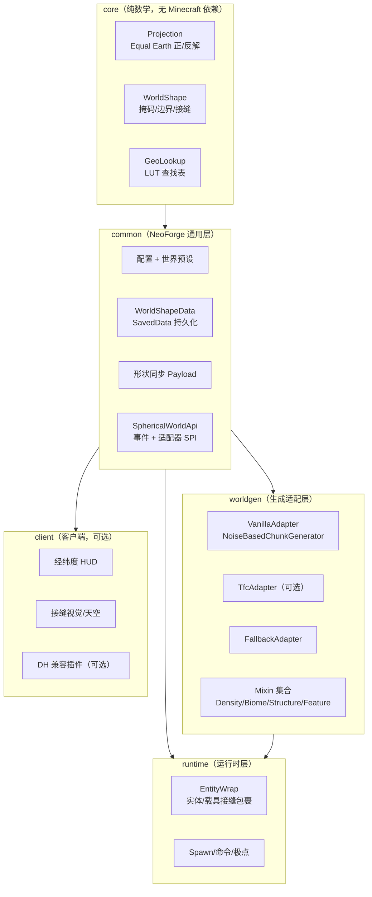
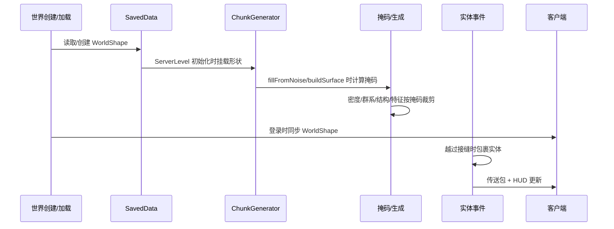
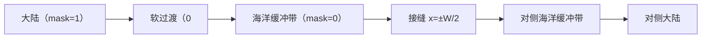

# 兼容原版与模组世界生成的球形世界模组——架构设计方案

> 目标：参考 TFC Eratosthenes 的"投影 + 接缝环绕"思路，但把适用范围从 TFC 扩展到原版、数据包、TerraBlender/Terralith 等世界生成体系，并将投影替换为 **Equal Earth**，同时对 Distant Horizons、c2me 等优化模组保持良好兼容。

---

## 0. 结论先行（TL;DR）

| 决策 | 建议 |
| --- | --- |
| 世界拓扑 | **有限圆柱世界**：x 方向周期（可环绕），z 方向到极线截止 |
| 世界生成 | **不重写噪声/区块系统**，只在 `ChunkGenerator` 层做"投影掩码" |
| 接缝处理 | **传送/静默包裹**（TFC Eratosthenes 路线），不做区块克隆 |
| 投影 | **Equal Earth**，用 LUT（查找表）消除反解开销 |
| 兼容原版 | Mixin `NoiseBasedChunkGenerator` / `BiomeSource` / `StructurePlacement` / `ChunkGenerator` |
| 兼容数据包 | 运行时掩码，不解析/改写数据包，Terralith 自动受益 |
| 兼容 TerraBlender | 同一套 `BiomeSource` 钩子；注意注入优先级或改用包装器 |
| 兼容 TFC | 独立可选适配模块，复用 `RegionGenerator` / `Region.Point` 注入点 |
| 兼容 DH | 接缝外生成"海洋缓冲带"；LOD 镜像做成可选插件，不硬依赖 |
| 兼容 c2me | 不碰 `ChunkMap`/`ServerChunkCache`/存储层；不可变 LUT + 每 generator 形状 + ThreadLocal |
| 真正无缝地形 | **不作为 MVP 目标**；需要周期性噪声或区块克隆，与 c2me/DH 冲突大 |

**一句话**：把"球形"实现为**一张有限的地图 + 可环绕的接缝 + 投影形状的大陆掩码**，而不是真正的球面体素世界。这是兼容性最好的工程折中。

---

## 1. 需求拆解与关键认知

### 1.1 功能需求

- 玩家可以向东/向西航行，绕过 180° 经线回到另一侧（含船、马、模组载具）。
- 大陆分布符合 Equal Earth 投影的轮廓（等面积、视觉熟悉）。
- 南北方向有极点/极线边界，不出现掉入虚空或坐标穿模。
- 坐标 HUD：显示纬度/经度。
- 配置/存档：世界形状（周长、垂直尺度、投影参数）在创建世界时确定，之后不可变。
- 服务端必需，客户端可选（客户端只负责 HUD/视觉）。

### 1.2 兼容性需求

- **原版世界生成**：`NoiseBasedChunkGenerator`（默认生成器）。
- **数据包世界生成**：Terralith 等通过 JSON 注入生物群系、密度函数、结构、特征。
- **TerraBlender**：向 `MultiNoiseBiomeSource` 注入生物群系。
- **TFC**：自定义 `RegionGenerator` 世界生成体系。
- **Distant Horizons**：远景 LOD 不应看到突兀的"世界边缘"。
- **c2me**：并行区块生成、区块 IO 优化，不能被我们的全局状态/注入破坏。
- **Sodium/Iris/Embeddium**：客户端渲染优化，不应被 HUD/天空渲染影响。
- **Create 等实体类模组**：载具/装置跨接缝时实体要正确环绕。

### 1.3 非目标（明确不做）

- **真正的球面体素世界**：需要立方球（cube-sphere）区块存储、球面物理、球面渲染，无法兼容原版世界生成和绝大多数模组。
- **完全无缝的地形**：需要周期性噪声或区块克隆；会让 Terralith/数据包密度函数失效，并与 c2me/DH 的缓存假设冲突。
- **兼容所有自定义 `ChunkGenerator`**：只能通过适配器 API 逐步支持；未知生成器退化为"实体环绕 + 有限边界"。

### 1.4 关键认知

Minecraft 的区块、光照、结构、实体追踪、地图模组全部假设**平面坐标**。因此"球形世界"在工程上只能是：

1. **拓扑**：一个圆柱（x 周期，z 有界），或带极盖的圆柱。
2. **投影**：把球面经纬度映射到平面 x/z；Equal Earth 是"地图显示"投影，不是生成噪声的坐标系。
3. **玩法**：玩家在投影平面上移动；到达接缝时坐标环绕；到达极线时被阻挡。

这与 TFC Eratosthenes 的本质一致：它并没有把 TFC 的世界生成改成球面噪声，而是用 Craster 投影的"半周长随纬度收缩"来裁剪大陆，并在边界传送。

---

## 2. 三条技术路线对比

| 路线 | 原理 | 兼容性 | 性能 | 视觉 | 工作量 | 结论 |
| --- | --- | --- | --- | --- | --- | --- |
| **A. 有限地图 + 接缝传送** | 世界有限；投影掩码裁剪大陆；玩家/实体越过接缝时传送到对侧 | **最高**：不碰区块存储/噪声 | 好 | 接缝处可能有跳变，可用海洋缓冲带隐藏 | 中 | **MVP 首选** |
| **B. Chunk 坐标环绕** | 把 x 坐标按周期取模，区块访问"看起来"无限 | 中：需要改 `ChunkMap`/`ChunkSource`；c2me/DH 风险高 | 中 | 无缝（理论上） | 高 | 仅作为实验模式 |
| **C. 球面 chunk 存储** | 立方球/球面体素，自定义区块坐标 | 低：原版世界生成/模组全部失效 | 低 | 真球体 | 极高 | 不推荐 |

### 2.1 为什么路线 B 不是"免费的无缝"

很多人以为"把 chunkX 对周期取模"就能无缝，其实不然：

- 区块坐标取模后，`x = W-1` 的下一个区块会映射到 `x = 0`；但噪声在 `W-1` 与 `0` 处的值并不连续。**取模只是让远处区块复用同一份数据，并不会让噪声场变成周期函数**。
- 要真正无缝，需要：
  - **周期性噪声**：把噪声定义在圆柱/球面上（例如用 `(cos θ, sin θ, z)` 采样 3D 噪声），这要求替换原版/数据包的所有密度函数，Terralith 直接失效。
  - 或**区块克隆**：生成边界区块后复制到对侧；需要复制方块、生物群系、光照、高度图、方块实体、实体、POI、刻列表，且与 c2me 的并行生成/缓存冲突。
  - 或**接缝混合**：在接缝附近用两个坐标的密度加权混合；只能做到视觉过渡，结构/特征仍会切断，且成本翻倍。

因此路线 B 只适合作为"视觉无缝"的可选实验模式，不能作为兼容性核心。

### 2.2 路线 A 的"无缝感"从哪来

- **海洋缓冲带**：在接缝两侧各留出 `seamBuffer`（例如 256~512 格）的纯海洋，大陆不接触接缝。玩家看到的是连续海面，传送时只有轻微位置跳变。
- **静默包裹 + 淡入淡出**：不发送"你穿越了 180° 经线"的聊天消息（可配置）；客户端在包裹时做短暂蓝色渐变/水下音效，掩盖跳变。
- **动量保留**：传送时保留 `deltaMovement`，船/马不会减速。
- **保底兜底**：对投掷物、掉落物、生物也做包裹，避免接缝处实体堆积。

这足以让玩家感觉"绕地球航行了一圈"，而不需要真正的无缝地形。

---

## 3. 总体架构

### 3.1 模块划分



### 3.2 数据流



### 3.3 线程模型（为 c2me 准备）

- **WorldShape 不可变**：创建后只读；所有投影/LUT 都是 `final` 数组。
- **每 generator 挂载**：不要把形状放在全局静态单例（TFC Eratosthenes 的 `MapProjectionHolder` 在多世界/并行生成下是隐患）。
- **每线程临时上下文**：`ThreadLocal<ChunkMask>` 用于在 `fillFromNoise` 期间传递当前区块的 16×16 掩码；用完清理，避免线程池污染。
- **无共享可变缓存**：需要缓存时用 `ConcurrentHashMap` + 不可变值，或干脆不缓存（LUT 已经足够快）。

---

## 4. Equal Earth 投影层

### 4.1 坐标约定

- **x 轴 = 经度方向**，周期为 `worldWidth`（可环绕）。
- **z 轴 = 纬度方向**，赤道在 `equatorZ`，北极在 `equatorZ - halfMeridian`，南极在 `equatorZ + halfMeridian`。
- 采用 Minecraft 的坐标习惯（z 向北为负），与 TFC Eratosthenes 一致。
- 对原版世界，建议 `equatorZ = 0`，即世界 z ∈ `[-H, +H]`；这样出生点 (0,0) 在赤道中心，符合直觉。
- 对 TFC 适配，可从 TFC 的 `temperatureScale` 推导 `H`，或沿用其 `equatorOffset`。

### 4.2 公式（d3-geo 版本）

设：

- $H$ = `halfMeridian`（赤道到极点的方块距离）；
- $R$ = `widthToHeightRatio = (eastEdge - westEdge) / 180`；
- $\varphi$ = 纬度（度），$\lambda$ = 经度（度）；
- $\theta = \arcsin\left(\frac{\sqrt{3}}{2}\sin\varphi\right)$；
- 常量：
  - $A_1 = 1.340264$
  - $A_2 = -0.081106$
  - $A_3 = 0.000893$
  - $A_4 = 0.003796$
  - $M = \sqrt{3}/2$

正向（经纬度 → 平面）：

$$
x = \frac{\lambda \cos\theta}{M\left(A_1 + 3A_2\theta^2 + \theta^6(7A_3 + 9A_4\theta^2)\right)}
$$

$$
y = \theta\left(A_1 + A_2\theta^2 + \theta^6(A_3 + A_4\theta^2)\right)
$$

反解（平面 → 纬度）：

- 先由 $y$ 用牛顿迭代解出 $\theta$：
  $$
  f(\theta) = \theta(A_1 + A_2\theta^2 + \theta^6(A_3 + A_4\theta^2)) - y = 0
  $$
  $$
  f'(\theta) = A_1 + 3A_2\theta^2 + \theta^6(7A_3 + 9A_4\theta^2)
  $$
- 再求 $\varphi = \arcsin(\sin\theta / M)$。

TFC Eratosthenes 的 `EqualEarth` 代码已经实现了这套逻辑，并引入两个归一化常数：

- `MAGIC_NUMBER = 1.317362725`：使 $y=1.317362725$ 对应 90°；
- `MAGIC_NUMBER_2 = 1.1607025861777`：使赤道处的相对宽度归一化为 1。

### 4.3 半宽、边界与掩码

当前纬度 $\varphi$ 处的**半宽**（从中央经线到地图边缘的方块距离）：

$$
\text{halfWidth}(\varphi) =
H \cdot R \cdot \text{relativeWidth}(\varphi) \cdot \text{MAGIC\_NUMBER\_2}
$$

其中：

$$
\text{relativeWidth}(\varphi) =
\frac{\cos\theta}{M\left(A_1 + 3A_2\theta^2 + \theta^6(7A_3 + 9A_4\theta^2)\right)}
$$

- 赤道处 $\text{relativeWidth}(0) \cdot \text{MAGIC\_NUMBER\_2} = 1$，因此 `halfWidth(0) = H * R`。
- 完整世界 $R = 360/180 = 2$，赤道总宽 $4H$，世界高 $2H$，比例 2:1。
- 半世界（新大陆/旧大陆）$R = 180/180 = 1$，赤道总宽 $2H$，比例 1:1。

**Equal Earth 的极点是一条线，不是一个点**：

- $\varphi = 90°$ 时 $\theta = \pi/3$，$\text{relativeWidth} \approx 0.5104$，乘 `MAGIC_NUMBER_2` 后约 **0.5924**。
- 即极线宽度约为赤道宽度的 59%，不是 0。
- 这与 Craster 抛物线投影（$\cos 90° = 0$，极点是奇点）完全不同：**Equal Earth 不需要"极点推回"来避免坐标奇点，只需要在极线处做边界墙/海洋缓冲**。

### 4.4 边界模式：矩形还是投影轮廓？

| 模式 | 可玩区域 | 接缝 | 优点 | 缺点 |
| --- | --- | --- | --- | --- |
| **矩形模式（推荐 MVP）** | x ∈ `[-W/2, W/2]`，z ∈ `[-H, H]` | 直线 x = ±W/2 | 传送/区块/DH/c2me 最简单 | 四个角落是地图外的海洋 |
| **投影轮廓模式** | 由 `halfWidth(z)` 定义的 Equal Earth 叶形 | 曲线 x = ±halfWidth(z) | 视觉上就是一张世界地图 | 边界弯曲，传送、结构、DH 都更复杂 |

**建议**：

- MVP 用**矩形模式**：世界边界是直的，接缝是直的；Equal Earth 只用于**大陆掩码**和经纬度显示。
- 后续可加"投影轮廓模式"作为可选视觉模式：用 `halfWidth(z)` 做边界，边界外强制海洋；接缝传送时目标 x 取 `-x`（同一 z 的半宽对称）。
- 两种模式共用同一套 `WorldShape` 接口，只是 `seamX(z)` 的实现不同。

### 4.5 性能：必须用 LUT

Equal Earth 的反解每次要迭代 12 次（含 `asin`/`sin`），如果在每个方块/每个密度采样点都算，性能不可接受。

方案：

1. **z → latitude 表**：在 `[-H, H]` 上采样 4096 或 8192 个点，线性插值。
2. **latitude → halfWidth 表**：同样采样 4096 个点，或直接对 `z` 建 `halfWidth` 表。
3. **x → longitude**：只在 HUD/传送消息时计算，不需要每方块。
4. **掩码**：用 `min(edgeDistance, poleDistance)` 的 `smoothstep`，全部是加减乘，无三角函数。

LUT 在 `WorldShape` 构造时生成一次，之后只读；对 c2me 的并行生成线程安全。

### 4.6 投影接口（示意）

```java
public interface Projection {
    double halfMeridian();                  // H
    double equatorZ();                      // 赤道 z
    double widthToHeightRatio();            // R
    double halfWidthAtZ(double z);          // 当前纬度的半宽
    double latitudeAtZ(double z);           // 度
    double zAtLatitude(double lat);         // 度 -> z
    double longitudeAt(double x, double z); // 度
    double xAtLongitude(double lon, double z);
    boolean hasPoleLine();                  // Equal Earth = true
}
```

> 注意：`xAtLongitude`/`longitudeAt` 只用于显示/传送消息；生成掩码只用 `halfWidthAtZ` 和 `z`。

---

## 5. 世界形状层

### 5.1 `WorldShape` 数据模型

```java
public record WorldShape(
    String id,                 // "equal_earth_full" 等
    Projection projection,
    double seamBuffer,         // 接缝海洋带宽（方块）
    double polarBuffer,        // 极线海洋/冰盖带宽
    double structureMargin,    // 结构/特征距边界的额外余量
    double oceanFloorY,        // 外部海洋的海床高度
    Holder<Biome> fallbackBiome,
    int version
) {
    public double mask(double x, double z) { ... }
    public boolean isInside(double x, double z) { ... }
    public double seamX(double z) { ... }
}
```

### 5.2 掩码函数

矩形模式下：

```java
double edge = seamX(z) - Math.abs(x);        // 到左右接缝的距离
double pole = H - Math.abs(z - equatorZ);    // 到南北极线的距离
double d = Math.min(edge, pole);
return smoothstep(0, buffer, d);             // 0 = 纯海洋，1 = 完全陆地
```

投影轮廓模式下：

```java
double edge = projection.halfWidthAtZ(z) - Math.abs(x);
double pole = H - Math.abs(z - equatorZ);
double d = Math.min(edge, pole);
return smoothstep(0, buffer, d);
```

`smoothstep(0, buffer, d)` 让大陆边缘平滑过渡到海洋，避免"悬崖式"边界。`seamBuffer` 内 mask 恒为 0，保证接缝是纯海洋；`structureMargin` 内不生成结构/特征。

### 5.3 持久化：世界形状必须跟存档走

- 用 `SavedData`（例如 `spherical_world.dat`）保存在主世界的数据目录中。
- 字段：投影 ID、`H`、`R`、`equatorZ`、`seamBuffer`、`polarBuffer`、`fallbackBiome`、`version`、`seedSalt`。
- **首次创建世界时**从配置/预设生成；之后**以存档为准**，配置只影响新世界。
- 如果配置与存档不一致：记录警告，继续使用存档形状（避免已生成区块错位）。
- 多维度：`SavedData` 中按维度 ID 存一个 map；默认只对主世界生效，其他维度可配置为"普通"或"独立形状"。

### 5.4 数据包与世界预设

- 提供 `data/<namespace>/spherical_world/shape/*.json`，让整合包定义"地球""大世界""小世界"等预设。
- 世界创建界面通过 `WorldPreset` 或 `CreateWorldScreen` 注入选择项；预设只是把 shape JSON 写入 `SavedData`。
- MVP 可以先只做配置项，后续再加 UI；但**形状必须持久化**，不能只靠配置文件。

### 5.5 网络同步

- 服务端在玩家登录/重生时发送 `WorldShapePayload`（投影参数、边界、HUD 开关）。
- 客户端保存到 `ClientWorldShape`，用于 HUD、接缝特效、地图模组 API。
- 客户端没装模组：服务端照常传送，客户端无 HUD；服务端不依赖客户端。
- 客户端装了模组但服务器没装：收不到 payload，HUD 显示"不可用"，不影响游戏。

---

## 6. 世界生成适配层

### 6.1 通用注入点

目标：**不改区块存储、不改噪声实现、不改数据包加载**，只在生成管线的"出入口"做裁剪。

| 注入点 | 用途 | 风险 |
| --- | --- | --- |
| `ServerLevel` 初始化 | 把 `WorldShape` 挂到 `ChunkGenerator`/`BiomeSource` | 低 |
| `ChunkGenerator#createStructures` | 跳过边界缓冲内的结构 | 低 |
| `ChunkGenerator#applyBiomeDecoration` | 跳过边界缓冲内的特征 | 低 |
| `ChunkGenerator#applyCarvers` | 跳过外部雕刻 | 低 |
| `ChunkGenerator#getBaseHeight`/`getBaseColumn` | 外部返回海洋基准 | 中 |
| `NoiseBasedChunkGenerator#fillFromNoise` / `NoiseChunk` | 包装密度函数 | 中 |
| `MultiNoiseBiomeSource#getNoiseBiome` | 外部返回海洋群系 | 中（TerraBlender） |
| `StructurePlacement#isStructureChunk` | 过滤结构放置 | 低 |
| `Entity#setPosRaw`/`move` | 实体接缝包裹 | 中 |

**原则**：

- 只用 `@Inject`/`@ModifyVariable`/`@Redirect` 等"温和"注入，不改方法体结构。
- 不注入 `ChunkMap`、`ServerChunkCache`、`ChunkHolder`、`ThreadedAnvilChunkStorage` 等 c2me 重点优化的类。
- 所有钩子先检查 `WorldShape` 是否存在；不存在时零开销地走原版路径。

### 6.2 原版 `NoiseBasedChunkGenerator` 适配（核心）

#### 6.2.1 密度掩码

目标：让投影外/缓冲带的地形变成海洋，而不是直接消失。

做法：

1. 在 `NoiseChunk` 创建处（`fillFromNoise` 调用 `NoiseChunk.forChunk(...)` 的位置）用 Mixin `@Redirect`/`@ModifyArg` 拿到 `NoiseRouter`。
2. 用 `DensityFunction` 包装器包住：
   - `finalDensity`
   - `initialDensityWithoutJaggedness`
   - 必要时 `fluidLevelFloodedness` / `fluidLevelSpread`
3. 包装器的 `compute(context)`：
   ```java
   double m = chunkMask(context.blockX(), context.blockZ());
   if (m <= 0) return oceanDensity(context.blockY());
   return delegate.compute(context) * m;
   ```
4. `fillArray` 先调用 delegate 填充，再按每个 index 的 `blockX/blockZ` 乘以掩码；掩码来自当前区块的 16×16 预计算表，避免每方块三角函数。

**关键点**：

- **不要把 x 坐标做投影重映射**（例如把 x 变成 `x * cos(lat)` 再采样噪声）。那会让结构/特征/数据包密度函数与地形不一致，Terralith 会出问题。投影只用于**掩码形状**和经纬度显示。
- 边界带用 `smoothstep` 做软过渡；接缝缓冲带内 mask=0，得到纯海洋。
- 区块完全在 mask=0 区域时，直接返回平坦海洋区块，**跳过噪声计算**（性能大杀器，也让 DH 有海可看）。

#### 6.2.2 生物群系掩码

- `MultiNoiseBiomeSource#getNoiseBiome(int qx, int qy, int qz, Climate.Sampler)` 接收的是 **quart 坐标**（block >> 2），掩码计算要 `qx << 2`、`qz << 2`。
- 在 `HEAD` 注入：如果 `mask <= 0`，返回 `fallbackBiome`（默认 `minecraft:deep_ocean`，可配置）。
- 掩码内不取消，让 TerraBlender/Terralith 正常选群系。
- 如果使用自定义 fallback 群系，记得把它加入 `collectPossibleBiomes`，否则特征生成可能忽略它。

**与 TerraBlender 的冲突**：

- TerraBlender 也注入 `MultiNoiseBiomeSource`；两个可取消的 HEAD 注入可能互相遮蔽。
- 方案 A：用 `@Mixin(priority = ...)` 让我们先执行（掩码外直接返回，掩码内放行）。
- 方案 B：不注入 `MultiNoiseBiomeSource`，而是在 `ServerLevel` 初始化时把 generator 的 `BiomeSource` 替换成 `MaskedBiomeSource` 包装器；包装器委托原 `BiomeSource`，只在掩码外返回 fallback。这样完全不碰 TerraBlender 的注入。代价是 final 字段替换和 codec 序列化要处理。
- 推荐：**MVP 用方案 A + 集成测试**；如果 TerraBlender 冲突严重，切方案 B。

#### 6.2.3 结构

- `StructurePlacement#isStructureChunk` 注入：如果该 chunk 位于 `seamBuffer + structureMargin` / `polarBuffer + structureMargin` 内，直接返回 false。
- `ChunkGenerator#createStructures` 注入：如果整个 chunk 在掩码外，取消。
- 结构余量要覆盖最大结构尺寸（村庄 ~100 格，古城 ~200 格）；默认 `structureMargin = 256`，可配置。
- 这样接缝附近不会出现"被切一半"的结构；海洋缓冲带也自然没有结构。

#### 6.2.4 特征

- `ChunkGenerator#applyBiomeDecoration` 注入：如果 chunk 在缓冲带/掩码外，取消。
- 树木、矿脉、植被在接缝附近被跳过；海洋缓冲带保持干净。
- 如果希望保留海洋特征（海带、珊瑚），可以按 feature 类型白名单；MVP 直接全部跳过更安全。

#### 6.2.5 雕刻、表面、高度图

- `applyCarvers`：掩码外取消，省性能。
- `buildSurface`：让表面规则在海洋群系下正常工作；外部密度为 0 → 海床/水；如果使用平坦海洋捷径，直接生成水+海床。
- `getBaseHeight`：掩码外返回 `oceanFloorY` 或海平面，避免其他模组把结构/生物放到"看不见的高地"。
- `getBaseColumn`：掩码外返回海洋列（水/海床），保证依赖列查询的模组一致。
- `getSeaLevel`：保持原版值；不要改，否则影响全局。

#### 6.2.6 外层海洋捷径

对完全在 `mask == 0` 区域的区块：

- 不调用 `NoiseChunk`，直接构造一个平坦海洋 `ChunkAccess`（海床 + 水）。
- 群系统一返回 fallback biome。
- 结构和特征全部跳过。
- 好处：外部海洋生成极快；DH 能看到连续海面；玩家不会看到虚空。

### 6.3 TerraBlender / Terralith

| 模组 | 类型 | 我们的策略 |
| --- | --- | --- |
| **Terralith** | 数据包（生物群系、密度函数、结构、特征） | 不解析、不改写；运行时密度/群系/结构/特征钩子自动生效 |
| **TerraBlender** | 代码模组（向 `MultiNoiseBiomeSource` 注入群系） | 同一套 `getNoiseBiome` 钩子；用 `priority` 或包装器避免注入冲突 |
| **其他数据包** | JSON 世界生成 | 同上；只要最终走 `NoiseBasedChunkGenerator` 就自动兼容 |

**测试重点**：

- Terralith + 我们的掩码：边界处是否出现异常群系/浮空结构。
- TerraBlender + 我们的 `getNoiseBiome`：掩码外是否稳定返回 fallback，掩码内是否正常选 TerraBlender 群系。
- 数据包自定义 `DensityFunction` 类型：包装根节点是否仍能正确 `mapAll`/`fillArray`。

### 6.4 TFC 适配（可选模块）

TFC 不使用 `NoiseBasedChunkGenerator`，需要独立适配器：

- `RegionGenerator#continentFactor`：返回 `WorldShape.mask`（或按 TFC 的软边界逻辑）。
- `Region.Point` 的 `setLand`/`setIsland`/`setMountain`/`setCoastalMountain`/`setVolcanic`/`setBarrierIsland`：掩码外取消。
- `OverworldClimateModel` 构造：挂载 `WorldShape`。
- `halfMeridian`：从 TFC `settings.temperatureScale()` 或 TFC Real World 的 `VERTICAL_SCALE` 读取。
- 实体环绕逻辑通用，不需要 TFC 专属代码。

**工程组织**：

- 独立 Gradle 子模块 `tfc-compat`，`compileOnly` TFC；或用 `IMixinConfigPlugin` 在 TFC 不存在时跳过 TFC mixin。
- 不要把 TFC 作为核心硬依赖；核心 jar 不应因为缺少 TFC 而崩溃。
- 如果使用单个 jar：TFC mixin 放在独立 config（`spherical_world.tfc.mixins.json`），用 `IMixinConfigPlugin.shouldApplyMixin` 检查 `ModList.isLoaded("tfc")`。

### 6.5 未知/自定义生成器

- 提供 `WorldgenAdapter` SPI：
  ```java
  public interface WorldgenAdapter {
      boolean supports(ServerLevel level);
      void attach(ServerLevel level, WorldShape shape);
      double maskAt(ServerLevel level, double x, double z);
      default void onChunkGenerate(...) {}
  }
  ```
- 内置：
  - `VanillaNoiseAdapter`（`NoiseBasedChunkGenerator`）
  - `TfcAdapter`（可选）
  - `FallbackAdapter`（后处理：生成后把掩码外方块替换为水/空气，并跳过特征）
- 未知生成器：如果没有适配器，至少保证：
  - 实体环绕（玩家/载具不会掉出世界）。
  - 通过世界边界/传送限制可玩区域。
  - 记录警告，提示整合包作者注册适配器。
- **不要**对未知生成器做激进的后处理；那会破坏模组内容。宁可退化，也不要崩溃。

### 6.6 接缝缓冲与结构余量



- `seamBuffer`：海洋带宽度，默认 256~512 格；确保玩家在接缝处看不到陆地断口。
- `polarBuffer`：极线缓冲，默认 128~256 格；配合边界墙/推回。
- `structureMargin`：结构/特征离缓冲带的额外距离，默认 256 格。
- 软过渡宽度：`softEdgeWidth`，默认 64~128 格；让海岸线自然。

### 6.7 Mixin 组织

建议按功能拆分配置：

```
mixins.spherical_world.json          # 核心：generator/biome/structure/entity
mixins.spherical_world.tfc.json      # 可选：TFC
mixins.spherical_world.dh.json       # 可选：DH（如需）
```

- 核心 mixin 尽量少、目标稳定。
- 兼容 mixin 用 `IMixinConfigPlugin` 条件加载，避免缺少依赖时类加载失败。
- 对每个目标方法记录 **Mixin 目标签名 + 适用版本**，升级 MC 时逐个核对。

---

## 7. 运行时层

### 7.1 实体接缝包裹

**目标**：不只是玩家，船、马、矿车、投掷物、掉落物、生物都能环绕。

推荐钩子：`Entity#setPosRaw(double x, double y, double z)`（服务端）。

```java
@Mixin(Entity.class)
abstract class EntityWrapMixin {
    @Inject(method = "setPosRaw", at = @At("HEAD"))
    private void spherical$wrap(double x, double y, double z, CallbackInfo ci) {
        // 1. 仅服务端；仅主世界/配置了形状的维度
        // 2. 防递归：当前实体正在被包裹时直接返回
        // 3. 只处理根载具（getRootVehicle() == this）
        // 4. 计算当前 z 的 seamX；若 |x| > seamX + grace，包裹
        // 5. 传送根载具 + 所有乘客（同一 delta）
        // 6. 保留 deltaMovement；fallDistance = 0；hurtMarked = true
    }
}
```

要点：

- **只处理根载具**：乘客跟随载具；如果对乘客单独包裹，会和载具位置打架。
- **包裹整棵树**：`rootVehicle` + `getPassengers()` 递归；先用 `unRide`，传送，再 `startRiding`（TFC Eratosthenes 的做法）。
- **保留动量**：`Vec3 movement = entity.getKnownMovement()`；传送后 `setDeltaMovement(movement)`。
- **防递归**：用 `@Unique boolean wrapping` 或 `ThreadLocal` 标记。
- **性能**：`setPosRaw` 是热路径；先做 `if (shape == null) return;`，再做一次 `|x| < seamX - margin` 的快速判断，避免每 tick 做复杂计算。`seamX(z)` 用 LUT。
- **客户端**：客户端不包裹（服务端权威）；客户端可能预测越过接缝，收到传送包后修正。可以在客户端做"预测包裹"减少回弹，但要以服务端为准。
- **玩家**：优先用 `ServerPlayer#teleportTo` 发送传送包；非玩家实体用 `teleportTo` + `hurtMarked`/`hasImpulse`。测试不同实体类型的客户端插值。

### 7.2 载具

- 船/马/矿车：包裹根载具 + 乘客；保留乘客的骑乘关系。
- 模组载具（Nifty Ships、Small Ships、Create 装置）：只要是 `Entity` 且有 `getRootVehicle()`，通用逻辑就能工作；不需要硬编码模组类。
- 如果载具是多实体组合（Create 的 contraption），包裹根实体；附属实体如果独立移动，需要它们自己也走 `setPosRaw` 钩子。
- 测试：步行、骑马、坐船、坐矿车、坐模组船、被投掷物击中、掉落物跨接缝。

### 7.3 玩家传送与视觉

- 触发距离：`|x| > seamX(z) + meridianGrace`；`meridianGrace` 默认 8~40 格，避免在边缘反复触发。
- 目标：`x' = -x ± 2 * overshoot`，保持 z/y；对矩形模式 `seamX = W/2`。
- 传送后：
  - `fallDistance = 0`
  - `hurtMarked = true`
  - 保留 `deltaMovement`
  - 确保目标区块已加载（`ServerLevel#getChunk` 或让 tracker 处理）
- 视觉：
  - 默认静默包裹；可选聊天栏提示"已环绕 180° 经线"。
  - 客户端淡入淡出/水下音效，掩盖位置跳变。
  - 不要用"传送门"式黑屏，太打断航行。
- 防作弊：服务端权威，客户端不能通过伪造坐标跳过包裹；所有位置包都经过服务端 `setPosRaw` 钩子。

### 7.4 极点/极线（Equal Earth 特有）

- Equal Earth 的极点是一条**有限宽度的极线**，不是点；没有 Craster 的坐标奇点。
- 处理方式：
  - `polarBuffer` 内 mask=0（海洋/冰盖）。
  - 在 `z = equatorZ ± (H - polarMargin)` 处设置**边界墙/推回**，阻止玩家到达极线边缘。
  - 如果玩家沿极线东西移动，接缝包裹仍然有效（同一 z，x 对称）。
- **可选"极盖模式"**：如果希望像真球一样"越过极点到达另一侧"，可以做一个自定义的极盖映射：
  - 当 `z` 超过 `H` 时，映射到 `z' = 2H - z`，`x' = x + W/2`（mod W）。
  - 这会把极线折叠成一个点，但地形在极点两侧不连续，需要传送 + 视觉过渡；作为可选玩法，不作为默认。
- **不要在 Equal Earth 上套用 Craster 的"极点推回"公式**（`-H + offset ± polarAreaSize` 之类）；那会让极线行为错误。

### 7.5 出生点与命令

- 出生点：默认 `(0, equatorZ)`；如果该点是海洋，向内搜索最近的陆地（用 `getBaseHeight` + 群系判断），或由世界预设指定。
- 在 `ServerLevel` 初始化时调用 `setDefaultSpawnPos`；已有存档不要强行移动出生点。
- 命令：
  - `/sphere info`：显示形状、周长、H、接缝位置。
  - `/sphere coords`：当前 x/z → 纬度/经度。
  - `/sphere locate <lat> <lon>`：经纬度 → x/z。
  - `/sphere tp <lat> <lon>`：传送到经纬度（自动包裹）。
  - `/sphere shape reload`：仅调试用；正式版不允许改形状。
- `/locate structure`：如果结构放置被过滤，原版 `/locate` 不会找到边界外结构；如果发现遗漏，注入 `LocateCommand` 过滤结果。

### 7.6 客户端同步

- 登录/重生/维度切换时发送 `WorldShapePayload`。
- 客户端保存 `ClientWorldShape`；HUD 用 LUT 计算经纬度。
- 如果服务端没发 payload：HUD 显示"未连接球形世界服务器"，其余功能禁用。
- 形状在会话内不变；不需要高频同步。

---

## 8. 客户端与优化模组兼容

### 8.1 HUD / 地图

- HUD：`Lat: 45.123 Long: 120.456`，可配置位置/开关。
- 可选小地图/地球仪：用 `ClientWorldShape` 画一个 Equal Earth 轮廓，标出玩家位置；纯客户端，不影响服务端。
- 地图模组（Xaero/Journeymap）：它们看到的是有限矩形地图；这是可接受的。提供 API 让地图模组读取经纬度；不强行改它们的渲染。
- 指南针：原版指南针指向世界出生点；跨接缝时可能指向"绕远路"的方向。可选做"环绕感知"的指南针，但不强求。

### 8.2 Distant Horizons

DH 的难点：它渲染玩家周围的 LOD，世界边缘可能露出"虚空/断崖"。

策略分层：

1. **海洋缓冲带（必做）**：接缝外生成平坦海洋，DH 看到的是海，不是虚空。这能解决大部分视觉问题。
2. **限制 DH 渲染距离（配置建议）**：如果 LOD 距离超过世界边界，建议把 DH 的 `maxRenderDistance` 调到能看到边界海面的范围；或使用自定义维度雾效。
3. **LOD 镜像插件（可选，进阶）**：
   - 优先使用 DH 公开 API（`DhApi` 及其 level/LOD 数据接口，具体类名随 DH 版本变化）。
   - 在玩家靠近接缝时，把对侧已加载的 LOD 数据按 `x ± W` 平移镜像，让 DH 看到连续远景。
   - 如果 API 不足，做**版本锁定的 compat 模块**（例如只支持 DH 2.x 的某几个版本），绝不把 DH 内部类作为硬依赖。
4. **地球曲率设置**：DH 有 "Earth Curve Ratio"；根据世界半径给一个推荐值（类似 TFC Eratosthenes 建议 160）。具体换算按 DH 版本验证。

**不要做**：Mixin DH 的区块缓存/渲染核心；DH 更新频繁，维护成本极高。

### 8.3 c2me

c2me 是服务端优化模组，重点是区块生成并行化、IO、数学优化。

兼容原则：

- **不碰区块系统**：不注入 `ChunkMap`、`ServerChunkCache`、`ChunkHolder`、`ThreadedAnvilChunkStorage`、`ChunkSerializer`。
- **无全局可变状态**：`WorldShape` 挂在 generator 实例上；不要用 TFC Eratosthenes 式的静态 `MapProjectionHolder`。
- **不可变 LUT**：所有查找表 `final`，构造后只读。
- **ThreadLocal 上下文**：`fillFromNoise` 期间设置当前 chunk mask；用 `try/finally` 清理。c2me 的 worker 线程复用线程池，必须清理。
- **避免每方块分配**：`DensityFunction` 包装器不要 new 对象；用原始数组。
- **可关闭开关**：如果 c2me 的某个 worldgen 模块与密度包装冲突，提供配置项"禁用密度包装，改用后处理掩码"（性能差但能用）。
- **测试矩阵**：c2me 单独、c2me + DH、c2me + TerraBlender、c2me + Terralith；重点看区块生成死锁、形状丢失、群系错乱。

### 8.4 Sodium / Iris / Embeddium

- 这些是客户端渲染优化；我们的 HUD/天空/接缝特效应使用标准渲染 API。
- 如果做自定义天空/雾效，避免 Mixin 到 Sodium 的渲染管线；优先用 `DimensionSpecialEffects`/`FogRenderer` 等原版钩子。
- Iris 光影下自定义天空可能被覆盖；提供"兼容模式"开关，关闭自定义天空只保留 HUD。

### 8.5 兼容矩阵

| 模组/场景 | 策略 | 预期 |
| --- | --- | --- |
| 原版 `NoiseBasedChunkGenerator` | 密度/群系/结构/特征/高度钩子 | 完整 |
| Terralith（数据包） | 运行时掩码，不改数据包 | 完整 |
| TerraBlender | 同一 `BiomeSource` 钩子 + 优先级/包装器 | 完整（需集成测试） |
| TFC | 独立适配模块 | 完整 |
| Distant Horizons | 海洋缓冲 + 可选 LOD 镜像 | 部分/良好 |
| c2me | 不碰区块系统 + 线程安全 | 良好（需测试） |
| Sodium/Iris | 标准渲染钩子 | 完整 |
| Create/载具模组 | 根载具包裹 | 良好 |
| 地图模组 | 有限地图 + API | 部分 |
| 自定义 `ChunkGenerator` | 适配器 SPI/退化 | 部分 |

---

## 9. 性能设计

1. **LUT**：`z → latitude`、`z → halfWidth` 各 4096~8192 项；生成时零三角函数。
2. **每区块掩码**：在 `fillFromNoise` 开头算一次 16×16 掩码，存到 `ThreadLocal` 的 `float[256]`；密度包装器只查表。
3. **完全外部区块捷径**：mask 全 0 → 直接平坦海洋，跳过噪声/结构/特征/雕刻。
4. **完全内部区块**：mask 全 1 → 跳过掩码包装，走原版路径。
5. **边界区块**：只有边界带付出掩码成本；通常只占已加载区块的极小部分。
6. **结构/特征过滤**：在 chunk 级直接取消，避免生成后再删除。
7. **避免全局锁**：没有共享可变缓存；`WorldShape` 不可变。
8. **内存**：LUT 几百 KB；每线程 mask 1 KB；可忽略。
9. **基准**：对比原版同种子同区域的区块生成耗时；目标内部区块 < 5% 开销，外部区块显著更快。

---

## 10. 测试计划

### 10.1 单元测试（core）

- 正/反投影 round-trip：`(lat, lon) → (x, z) → (lat, lon)` 误差 < 1e-6。
- 已知点：赤道/本初子午线、±180°、±90°、地图四角。
- `halfWidth` 单调性：从赤道到极线递减（Equal Earth 的极线宽度约 0.59×赤道半宽）。
- 掩码连续性：沿接缝/极线采样，无跳变。
- LUT 插值误差：与精确公式对比，< 0.01°。

### 10.2 GameTest / 集成测试

- 新世界生成：出生点、边界海洋、掩码形状。
- 步行/骑马/坐船/矿车/模组载具跨接缝：位置、动量、乘客、掉落物。
- 投掷物/掉落物/生物跨接缝。
- 结构不跨接缝：村庄/古城/要塞在缓冲带外。
- 特征不跨接缝：树木/矿脉不在缓冲带内。
- 极点：走到极线边界，不落入虚空。
- 存档重启：形状、区块、结构一致。
- 专用服务器 + 纯客户端（无模组）连接。
- 客户端装模组 + 服务器无模组（HUD 降级）。
- `/locate`、`/tp`、`/setblock` 边界行为。

### 10.3 兼容测试

- Terralith 单独；Terralith + TerraBlender；Terralith + c2me。
- TFC 单独；TFC + TFC Real World；TFC + 我们的适配器。
- DH 单独；DH + c2me；DH + Iris。
- Create 载具跨接缝。
- 地图模组（Xaero/Journeymap）在有限世界中的表现。

### 10.4 确定性与性能

- 同种子 + 同形状 → 区块 NBT 哈希一致（多次生成/重启）。
- 内部区块生成耗时对比原版；外部海洋区块耗时对比。
- 并行生成（c2me）下无死锁、无形状串线。

---

## 11. 实施路线图

| 阶段 | 内容 | 产出 |
| --- | --- | --- |
| **Phase 0** | 纯数学 core：Equal Earth 正/反解、LUT、掩码、单元测试 | 可独立测试的投影库 |
| **Phase 1** | `WorldShape` + `SavedData` + 配置；原版密度/群系/高度钩子；平坦海洋捷径 | 有限世界 MVP（原版可玩） |
| **Phase 2** | 实体/载具接缝包裹；玩家传送；HUD；出生点 | 可环绕航行的 MVP |
| **Phase 3** | 结构/特征/雕刻过滤；接缝缓冲带；软边界；命令 | 视觉与玩法完整 |
| **Phase 4** | TFC 适配模块（`RegionGenerator`/`Region.Point`） | TFC 兼容（✅ 0.9.4：可选 Mixin + `WorldgenAdapter`） |
| **Phase 5** | c2me/DH 兼容测试与插件；性能优化 | 优化模组兼容（✅ 0.9.4：每区块掩码缓存、退化开关、DH 推荐值） |
| **Phase 6** | 数据包形状预设、世界创建 UI、API/事件、文档 | 整合包友好（✅ 0.9.4：预设、事件、SPI、文档） |

**MVP 范围建议**：Phase 0~3。先确保"原版 + Terralith + TerraBlender"能玩，再扩展 TFC/DH。

> 实现进度：Phase 4–6 已在 **0.9.4** 完成（TFC 可选适配、c2me/DH 兼容说明与性能优化、
> 数据包预设、公开事件/SPI、文档）。详见仓库根目录 `README.md` 与
> `docs/Phase4-6-实现说明.md`。

---

## 12. 风险与限制

| 风险 | 影响 | 缓解 |
| --- | --- | --- |
| 不是真正的球体 | 玩家可能期待"越过极点" | 文档说明"有限圆柱 + 投影"；可选极盖模式 |
| Equal Earth 极线不是点 | 极点是一条宽线，观感奇怪 | 极线海洋/冰盖 + 边界墙；可选极盖压缩 |
| 接缝传送有跳变 | 视觉不完美 | 海洋缓冲带 + 淡入淡出 + 静默包裹 |
| 结构/特征跨接缝 | 被切断 | `structureMargin` + 缓冲带；接受极少数例外 |
| 未知生成器 | 掩码不生效 | 适配器 SPI + 退化模式 + 警告 |
| TerraBlender 注入冲突 | 群系错误/崩溃 | 优先级/包装器；集成测试 |
| c2me 冲突 | 生成死锁/形状丢失 | 不碰区块系统；ThreadLocal 清理；可关闭开关 |
| DH 边缘可见 | 远景断崖 | 海洋缓冲；LOD 镜像插件；配置建议 |
| 世界过大 | 存档膨胀 | 默认小周长（如 20000~40000 格）；可配置 |
| 配置改动破坏存档 | 区块错位 | 形状写入 `SavedData`，以存档为准 |

---

## 13. 关键接口草图

### 13.1 投影

```java
public interface Projection {
    double halfMeridian();
    double equatorZ();
    double halfWidthAtZ(double z);
    double latitudeAtZ(double z);
    double longitudeAt(double x, double z);
    double xAtLongitude(double lon, double z);
    boolean hasPoleLine();
}
```

### 13.2 世界形状

```java
public record WorldShape(
    String id,
    Projection projection,
    double seamBuffer,
    double polarBuffer,
    double structureMargin,
    double oceanFloorY,
    Holder<Biome> fallbackBiome
) {
    public double mask(double x, double z) {
        double edge = projection.halfWidthAtZ(z) - Math.abs(x) - seamBuffer;
        double pole = projection.halfMeridian()
                - Math.abs(z - projection.equatorZ()) - polarBuffer;
        double d = Math.min(edge, pole);
        return d <= 0 ? 0 : Math.min(1, d / softEdgeWidth);
    }

    public boolean isInside(double x, double z) {
        return mask(x, z) > 0;
    }
}
```

### 13.3 生成器挂载

```java
public interface ShapeAware {
    WorldShape spherical$shape();
    void spherical$setShape(WorldShape shape);
}

// ServerLevel 初始化时：
ChunkGenerator generator = level.getChunkSource().getGenerator();
if (generator instanceof ShapeAware aware) {
    aware.spherical$setShape(WorldShapeData.get(level).shape());
}
```

### 13.4 密度包装

```java
final class MaskedDensity implements DensityFunction {
    private final DensityFunction delegate;
    private final WorldShape shape;
    private final ThreadLocal<float[]> chunkMask;

    @Override
    public double compute(FunctionContext ctx) {
        float m = maskAt(ctx.blockX(), ctx.blockZ());
        if (m <= 0) return oceanDensity(ctx.blockY());
        return delegate.compute(ctx) * m;
    }

    // fillArray: delegate.fillArray(array, provider);
    //            for each i: array[i] *= maskAt(provider.forIndex(i));
}
```

### 13.5 实体包裹

```java
// 伪代码：只在服务端、只处理根载具
if (level instanceof ServerLevel server
        && shape != null
        && entity.getRootVehicle() == entity) {
    double seam = shape.projection().halfWidthAtZ(entity.getZ());
    if (Math.abs(entity.getX()) > seam + grace) {
        double newX = -entity.getX() + Math.signum(entity.getX()) * overshoot * 2;
        teleportTree(entity, newX, entity.getY(), entity.getZ());
    }
}
```

---

## 14. 设计要点回顾

1. **兼容性的核心是"少改"**：只做生成管线的掩码和实体包裹，不改区块存储、不改噪声、不改数据包。
2. **投影只影响"哪里能生成陆地"**，不影响"噪声如何采样"；这是 Terralith/TerraBlender 兼容的关键。
3. **Equal Earth 的极线**与 Craster 的极点不同：不需要极点推回，但需要极线缓冲/边界。
4. **接缝用海洋缓冲带藏起来**：这比追求真正无缝更划算，也让 DH 看到的是海而不是虚空。
5. **c2me 友好 = 不可变 + 无全局状态 + 不碰区块系统 + ThreadLocal 清理**。
6. **DH 友好 = 海洋缓冲 + 可选 LOD 插件**；不要把 DH 内部类作为硬依赖。
7. **TFC 是适配器，不是核心**：核心 jar 不依赖 TFC；TFC 模块可选加载。
8. **世界形状跟存档走**：配置只影响新世界；存档中的形状不可变，避免区块错位。

---

## 15. 参考与灵感

- TFC Eratosthenes 源码（本仓库）：投影接口、Craster/Equal Earth 实现、`RegionGenerator`/`Point` 注入、实体载具传送。
- d3-geo `equalEarth` 投影实现（Equal Earth 公式来源）。
- Equal Earth 投影论文：Šavrič, Patterson, Jenny (2018)。
- NeoForge 1.21.1 `ChunkGenerator` / `NoiseBasedChunkGenerator` / `DensityFunction` / `BiomeSource` API。
- TerraBlender 的 `MultiNoiseBiomeSource` 注入方式（集成时以实际版本为准）。
- Distant Horizons 公开 API（以实际版本为准）。
- c2me 的并行世界生成与区块 IO 优化（避免与其竞争注入点）。
